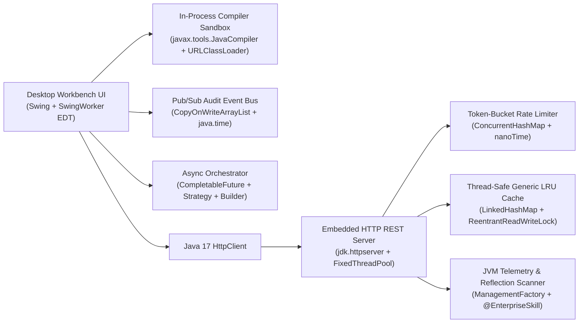

# Java Grind Studio — Core-to-Enterprise Java 17 Workbench & Live Compiler Sandbox


**Java Grind Studio** is a zero-dependency **Java 17 Desktop Engineering Workbench** built purely on standard JDK 17 APIs (`javax.tools`, `jdk.httpserver`, `java.net.http`, `java.lang.management`, `java.util.concurrent`, `java.nio.file`, `java.lang.reflect`, and `javax.swing`).

It serves both as an **interactive Java learning & coding environment** (8 runnable playgrounds, 36 auto-graded coding suites, 20 technical quizzes, 25 flashcards) and as a **living reference implementation of production enterprise Java engineering patterns**.

---

## System Architecture



---

## Implemented Java 17 & Enterprise Engineering Skills Matrix

Every capability listed below is implemented from scratch in clean, zero-warning (`-Xlint:all -Werror`) Java 17 source code:

| Engineering Domain | Implemented Java Concepts & Patterns | Source Implementation |
|---|---|---|
| **Modern Java 17 Language** | `sealed` interfaces & algebraic `ExecutionOutcome<T>` (`Success`, `Failure`, `RateLimited`), `record` data carriers, Pattern Matching for `instanceof`, Switch Expressions, Text Blocks | [`ExecutionOutcome.java`](src/main/java/javagrind/enterprise/ExecutionOutcome.java), [`L03_OOPPillarsAndJava17.java`](src/main/java/javagrind/learn/L03_OOPPillarsAndJava17.java) |
| **Compiler API, ClassLoaders & Sandboxing** | Dynamic compilation via `javax.tools.JavaCompiler`, `DiagnosticCollector` line-level error reporting, per-run isolated `URLClassLoader`, daemon `ExecutorService` + `Future.get(timeout)` infinite-loop guard | [`LiveJavaEngine.java`](src/main/java/javagrind/app/LiveJavaEngine.java) |
| **Metaprogramming & Reflection** | Custom `@Retention(RUNTIME)` `@Repeatable` `@EnterpriseSkill` annotation, runtime bytecode discovery via `Class.getAnnotationsByType`, reflective test invocation (`Method`, `Constructor`, `Field`) | [`EnterpriseSkill.java`](src/main/java/javagrind/enterprise/EnterpriseSkill.java), [`SkillRegistryScanner.java`](src/main/java/javagrind/enterprise/SkillRegistryScanner.java), [`ProblemBank.java`](src/main/java/javagrind/app/ProblemBank.java) |
| **Multithreading, Locks & Async Pipelines** | Parallel non-blocking fan-out/fan-in with `CompletableFuture` (`supplyAsync`, `thenCombine`, `orTimeout`, `exceptionally` fallback), `ReentrantReadWriteLock`, `ConcurrentHashMap`, `CopyOnWriteArrayList`, `AtomicLong` / `AtomicInteger`, `SwingWorker` | [`AsyncPipelineOrchestrator.java`](src/main/java/javagrind/enterprise/AsyncPipelineOrchestrator.java), [`ThreadSafeLruCache.java`](src/main/java/javagrind/enterprise/ThreadSafeLruCache.java), [`L06_MultithreadingAndJVM.java`](src/main/java/javagrind/learn/L06_MultithreadingAndJVM.java) |
| **Microservices, HTTP REST & Rate Limiting** | Multithreaded HTTP REST server (`com.sun.net.httpserver.HttpServer`), Java 17 `HttpClient`, per-client Token-Bucket Rate Limiter returning `HTTP 429 Too Many Requests`, response caching headers, JMX `ManagementFactory` heap/thread health endpoint | [`EmbeddedRestServer.java`](src/main/java/javagrind/enterprise/EmbeddedRestServer.java), [`TokenBucketRateLimiter.java`](src/main/java/javagrind/enterprise/TokenBucketRateLimiter.java) |
| **GoF Design Patterns & SOLID** | **Singleton** (Initialization-on-Demand Holder), **Builder** (fluent immutable `CheckoutQuote.Builder`), **Strategy** (`DiscountStrategy` functional policies), **Observer / Event Bus** (`AuditEventBus`), **Middleware/Decorator** | [`AuditEventBus.java`](src/main/java/javagrind/enterprise/AuditEventBus.java), [`AsyncPipelineOrchestrator.java`](src/main/java/javagrind/enterprise/AsyncPipelineOrchestrator.java) |
| **Collections, Generics & Stream API** | Custom access-ordered `LinkedHashMap` LRU eviction, `TreeSet`, `ArrayDeque`, `PriorityQueue` heaps, custom `Comparator` chains, `Stream` pipelines (`groupingBy`, `toMap`, `counting`, primitive streams), `Optional` | [`ThreadSafeLruCache.java`](src/main/java/javagrind/enterprise/ThreadSafeLruCache.java), [`L04_CollectionsAndGenerics.java`](src/main/java/javagrind/learn/L04_CollectionsAndGenerics.java), [`L05_ExceptionsAndStreams.java`](src/main/java/javagrind/learn/L05_ExceptionsAndStreams.java) |
| **Java NIO.2 & `java.time`** | `Files`, `Path`, recursive `Stream<Path>` cleanup, thread-safe `Properties` state repository, immutable `Instant` & `DateTimeFormatter` audit timestamps | [`ProgressStore.java`](src/main/java/javagrind/app/ProgressStore.java), [`AuditEventBus.java`](src/main/java/javagrind/enterprise/AuditEventBus.java) |
| **Data Structures & Algorithms** | 36 tested implementations across Number Theory, Two Pointers, Sliding/Streak Hashing, Singly Linked List pointer reversal, 2D Matrices, Space-Optimized 1D Dynamic Programming, OOP invariants, and `equals`/`hashCode` contracts | [`ProblemBank.java`](src/main/java/javagrind/app/ProblemBank.java), [`src/main/java/javagrind/solutions/`](src/main/java/javagrind/solutions) |

---

## Interactive Workbench Modules (5 Tabs)

1. **Learn & Live Playground (8 Modules)**: Structured guides paired with an editable Java 17 `Playground` that compiles and executes in-process (`Ctrl + Enter`).
2. **Coding Grind (36 Auto-Graded Suites)**: Line-numbered code editor with sub-50ms dynamic compilation, reflection test runner, hints, reference solutions, and persistent draft saving.
3. **MCQ & SQL Quiz Arena (20 Questions)**: Interactive quiz covering JVM memory traps, polymorphism edge cases, relational SQL (`DENSE_RANK()`, `HAVING`, `LEFT JOIN`), JDBC `PreparedStatement`, and REST semantics.
4. **Interview Flashcards & Study Planner**: 25 flip-cards for rapid verbal revision + persistent study checklist.
5. **Enterprise Architecture Lab**:
   - Start/stop the **Embedded HTTP REST Server** and dispatch live `HttpClient` requests (`GET /api/v1/health`, `/api/v1/skills`, `/api/v1/progress`).
   - Trigger an **8-request burst** to observe **Token-Bucket Rate Limiting (`HTTP 429`)** and **LRU Cache hit ratios** live.
   - Execute the **3-service parallel `CompletableFuture` pipeline** (both normal and simulated `503` fault-fallback mode).
   - Run the **Reflection `@EnterpriseSkill` Scanner** and monitor the real-time **`AuditEventBus`** stream.

---

## Quick Start

### Option A: IntelliJ IDEA (Recommended)
1. **File -> Open...** -> select this project folder (`pom.xml` configures Java 17 automatically with zero external downloads).
2. Ensure **Project SDK** is set to **JDK 17+**.
3. Open [`MainDashboard.java`](src/main/java/javagrind/MainDashboard.java) and click **`▶` Run** (`Shift + F10`).

### Option B: Command Line (JDK 17+)
```bash
# Compile all sources with strict zero-warning enforcement
mkdir -p target/classes
javac --release 17 -encoding UTF-8 -Xlint:all -Werror -d target/classes $(find src/main/java -name "*.java")

# Launch the Desktop Workbench UI
java -cp target/classes javagrind.MainDashboard

# Run full automated verification suite (8 Playgrounds + 36 Problem Suites + REST/Async/LRU/Reflection)
java -cp target/classes javagrind.MainDashboard --verify-app-engine
```
